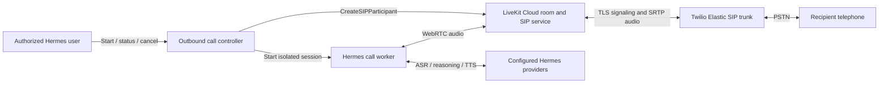

# Outbound phone calls through Twilio and LiveKit Cloud

This guide describes how to configure an outbound telephone path and how to
add that path to Hermes Agent through hermes-realtime. Twilio provides the
connection to the public switched telephone network (PSTN). LiveKit Cloud
bridges telephone audio into a room. Hermes supplies the conversation, speech
recognition, model, tools, and voice.

**The external-service setup is usable today. The Hermes outbound call
controller described here is a proposed extension, not an implemented
feature.** Creating a SIP trunk does not make Hermes able to dial. The current
plugin has no outbound phone tool, call registry, or per-call room launcher.

The design uses existing Hermes provider and voice configuration. It does not
require a particular inference service, model, voice, or OpenAI-compatible
Realtime endpoint. All account values below are placeholders. The example
telephone numbers are fictional; replace them before a controlled test.

Vendor references and examples were checked on 2026-09-21. The repository
baseline is version 0.4.0, with `livekit==1.1.14` and `livekit-api==1.2.0`.
The example schemas were checked with `livekit-protocol==1.1.26`; the CLI
syntax was checked with `lk` 2.18.5. Recheck schemas and console labels when
upgrading. Schema validation alone does not establish live interoperability.

## Contents

- [Architecture and terminology](#architecture-and-terminology)
- [Prerequisites and configuration inventory](#prerequisites-and-configuration-inventory)
- [Configure Twilio](#configure-twilio)
- [Configure LiveKit Cloud](#configure-livekit-cloud)
- [Verify the telephone path](#verify-the-telephone-path)
- [Existing Hermes behavior and integration gaps](#existing-hermes-behavior-and-integration-gaps)
- [Proposed Hermes call controller](#proposed-hermes-call-controller)
- [Audio, turn handling, and voice](#audio-turn-handling-and-voice)
- [Security and operational controls](#security-and-operational-controls)
- [Diagnostics and troubleshooting](#diagnostics-and-troubleshooting)
- [Implementation and acceptance plan](#implementation-and-acceptance-plan)

## Architecture and terminology



The controller handles authorization, dialing, time limits, state, and cleanup.
The worker handles the conversation and audio. Both can initially run inside
the same supervised process. Keep their responsibilities separate so a model
timeout cannot disable the call deadline or prevent hangup.

LiveKit starts the telephone leg when the backend requests a SIP participant
for a destination and room. LiveKit sends the SIP invitation to the carrier;
the carrier authenticates it and routes the call. The SIP participant becomes
the telephone's audio endpoint in the room.
See [LiveKit's outbound workflow](https://docs.livekit.io/telephony/making-calls/workflow-setup/).

| Term | Meaning in this setup |
| --- | --- |
| Twilio termination | Traffic from LiveKit through Twilio to a telephone; this is the outbound path. |
| Twilio origination | Traffic from a telephone through Twilio toward an application; this is the inbound path. |
| Twilio trunk SID | Twilio's trunk identifier, normally beginning `TK`. It is not a LiveKit trunk ID. |
| LiveKit outbound trunk | A stored carrier endpoint, authentication configuration, and caller-number list. Its ID normally begins `ST_`. |
| SIP participant | The telephone leg represented inside a LiveKit room. |
| Hermes participant | The worker that receives recipient speech and publishes the agent's speech. |
| SIP dispatch rule | Routing configuration for incoming SIP calls. Outbound calls explicitly name a room. |
| Agent dispatch | A job assignment to a worker registered with the LiveKit Agents framework. It is separate from a SIP dispatch rule. |

For outbound-only operation, configure a Twilio termination trunk and a LiveKit
outbound trunk. A LiveKit inbound trunk, inbound SIP dispatch rule, Twilio
origination URI, TwiML application, and voice webhook are not part of this
path. Twilio describes the direction of each trunk configuration in its
[Elastic SIP Trunking guide](https://www.twilio.com/docs/sip-trunking).

The ordinary Hermes Conference adapter joins rooms directly. It is not a
registered LiveKit Agents worker. An agent name in the LiveKit dashboard will
not launch it. A future implementation can introduce a framework worker, but
that is an additional integration decision.

## Prerequisites and configuration inventory

Prepare the following before dialing:

1. A Twilio account or subaccount with Elastic SIP Trunking access, available
   balance, an authorized caller number, and destination calling permissions.
2. A LiveKit Cloud project with SIP calling access, available quota, and a
   backend API key/secret pair for that exact project.
3. A reachable, supervised Hermes gateway or call worker with working speech
   recognition, model access, TTS, and the intended voice. Follow the
   [installation instructions](../README.md#install).
4. An owned or otherwise authorized recipient telephone for initial tests.
5. A way to terminate the exact test room if the worker fails.

Twilio's current limits page says SIP trunking requires an upgraded account.
Trial-related restrictions also vary by account and product; where a trial
path is available, both caller and recipient verification can be required.
Check actual account eligibility before diagnosing an application failure.
See [Twilio account and trial limits](https://www.twilio.com/docs/sip-trunking/scale-and-limits).

Keep this inventory in a private deployment record. Record secret references,
not secret values, in a repository or issue.

| Item | Example or form | Used by |
| --- | --- | --- |
| Twilio account/subaccount | Account that owns the trunk and authorized caller ID | Operator; optional provisioning/diagnostics service |
| Twilio trunk SID | `TK<placeholder>` | Operator diagnostics |
| Termination hostname | `<unique-trunk>.pstn.twilio.com` | LiveKit outbound trunk |
| Credential-list name | `Hermes LiveKit` | Twilio operator |
| SIP username | `hermes-livekit` | Twilio credential list and LiveKit trunk |
| SIP password | Secret-store reference | Twilio credential list and LiveKit trunk |
| Caller number | `+12025550100` | Twilio caller ID, LiveKit trunk, controller policy |
| LiveKit project URL | `wss://<project>.livekit.cloud` | Hermes RTC connection and server SDK |
| LiveKit API key/secret | Secret-store references | Trusted backend only |
| LiveKit outbound trunk ID | `ST_<placeholder>` | Call controller |
| Test recipient | `+12025550101` | Controlled test request |
| Hermes profile | Deployment-selected profile | Call worker |
| Runtime location | Supervised host/container | Operator |

These are three different credential systems:

- Twilio REST credentials administer the Twilio account.
- SIP username/password authorize carrier calls through the trunk.
- LiveKit API key/secret authorize the backend to manage LiveKit resources.

With a stored LiveKit trunk, ordinary dialing needs LiveKit credentials and
the trunk ID. The Hermes model does not need Twilio REST credentials or the
SIP password. Inference-provider credentials belong to the Hermes profile
and are separate from all three systems.

The Twilio and LiveKit console tabs may be closed after setup. Calls depend
on the services and running worker, not those tabs. A local worker must remain
awake and connected; closing its terminal or putting its computer to sleep
is not a deployment strategy.

The worker needs outbound connectivity to LiveKit signaling/media and its
speech/model providers. LiveKit Cloud operates the SIP bridge and TURN
fallback; this design does not require a public SIP listener on the Hermes
host. Test connectivity from the actual runtime network, including restrictive
firewalls, using the [LiveKit connection guide](https://docs.livekit.io/intro/basics/connect/).

## Configure Twilio

### 1. Select the account and caller number

Use the intended account/subaccount throughout setup. Choose a voice-capable
Twilio number owned by that account, or a caller ID verified for it. Keep the
country code and leading `+`; do not infer a country from a local-format
number. Twilio validates outbound caller ID; an arbitrary number in LiveKit
does not grant permission to use it.
See [Twilio caller-ID requirements](https://help.twilio.com/articles/223132147-Does-Elastic-SIP-Trunking-alter-the-caller-ID-on-calls-).

For outbound-only use, caller-ID authorization and inbound routing are
different concerns. Do not move an existing number from its current incoming
voice application just to configure outbound caller ID. Associating a number
with a trunk for origination changes where incoming calls go. If inbound
support is later added, plan that routing change separately.

### 2. Create the Elastic SIP trunk

In the Twilio console, open **Elastic SIP Trunking → Manage → Trunks** and
create a trunk with a descriptive name, such as `Hermes outbound`.

On **Termination**, select a unique termination name. Save the resulting
hostname, for example `<unique-trunk>.pstn.twilio.com`. This is the carrier
address LiveKit will call. Do not substitute the Twilio console URL, a
Programmable Voice SIP Domain, or the LiveKit project's SIP hostname.

### 3. Attach SIP authentication

Create a credential list, either through **Voice → Credential lists** or the
trunk's authentication controls. Give it a recognizable name. Add a dedicated
username and a strong generated password that meets Twilio's requirements.
Store the password securely; it must be entered identically in LiveKit.

Return to **Termination → Authentication → Credential Lists**, select the
list, and save the termination settings. Creating a list alone does not
attach it to the trunk. Reopen the page and verify the selected list.
These console steps are documented in
[LiveKit's Twilio setup guide](https://docs.livekit.io/telephony/start/providers/twilio/).

Use credential authentication as the initial setup. An IP ACL is a separate
control; do not enter a laptop's address as though it were the LiveKit Cloud
SIP service. If an ACL is required, use current vendor-published ranges and
verify how multiple authentication controls combine before enabling it.

### 4. Enable secure trunking

On the trunk's **General Settings**, enable **Secure Trunking** and save.
Configure LiveKit for TLS signaling and required SRTP in the next section.
Both ends must agree; TLS alone does not encrypt the audio. This protects the
LiveKit-to-Twilio network leg, not the entire PSTN path to the handset.
See [LiveKit secure trunking](https://docs.livekit.io/telephony/features/secure-trunking/).

Keep recording and call transfer disabled unless the application explicitly
needs them. Do not add an origination URI for this outbound-only setup.

### 5. Check destination permissions and capacity

In **Voice → Settings → Geo permissions**, enable only the destination
countries and number ranges the application needs. Save the changes. These
controls apply to Elastic SIP Trunking as well as Programmable Voice.
See [Twilio geographic permissions](https://www.twilio.com/docs/sip-trunking/voice-dialing-geographic-permissions).

Check balance, concurrency, and termination calls-per-second limits. Calls
per second measures call setup rate, not simultaneous conversations. The
controller needs both a rate limit and a concurrent-call limit.
See [Twilio termination CPS](https://www.twilio.com/docs/sip-trunking/cps-trunk-termination).

The Twilio completion record should contain the selected account, authorized
caller number, trunk SID, termination hostname, attached credential-list name,
secure-trunking setting, and permitted destinations.

## Configure LiveKit Cloud

### 1. Select the project and backend credentials

Use the same LiveKit project for the room, outbound trunk, and API key/secret.
Supply `LIVEKIT_URL`, `LIVEKIT_API_KEY`, and `LIVEKIT_API_SECRET` through the
worker's secret configuration. Existing environment names are described in
the [Conference configuration](../README.md#realtime-conference--livekit).
The Python server SDK accepts the project URL and handles the server API
connection; the browser client needs a short-lived participant token instead
of the API secret.

A normal room-join token is not a dialing credential. The control plane needs
the SIP call grant; trunk provisioning uses SIP admin privileges. Room
creation, inspection, and removal also require their corresponding room
grants. The server SDK signs request tokens from backend credentials.
See the [SIP API authorization reference](https://docs.livekit.io/reference/telephony/sip-api/)
and [room service authorization](https://docs.livekit.io/reference/other/roomservice-api/).

### 2. Create one reusable outbound trunk

Open **Telephony → SIP trunks → Create new trunk**. Select **Outbound**.
Use the form or JSON editor to configure these values:

| Setting | Value |
| --- | --- |
| Name | `Hermes via Twilio` |
| Address | The saved Twilio termination hostname; no `sip:`, `https://`, path, or recipient number |
| Numbers | Explicit authorized caller numbers, initially one |
| Authentication username/password | Exactly the credentials attached to Twilio's termination trunk |
| Transport | TLS |
| Media encryption | Require SRTP |

The JSON editor takes the trunk itself:

```json
{
  "name": "Hermes via Twilio",
  "address": "<unique-trunk>.pstn.twilio.com",
  "numbers": ["+12025550100"],
  "authUsername": "hermes-livekit",
  "authPassword": "<enter-from-secret-store>",
  "transport": "SIP_TRANSPORT_TLS",
  "media": {
    "encryption": "SIP_MEDIA_ENCRYPT_REQUIRE"
  }
}
```

Enter real credentials only in the trusted console or provisioning process.
Do not save a filled-in example in Git. If using `lk sip outbound create`,
its request file wraps this object in a top-level `trunk` field. Do not paste
that wrapper into the dashboard's trunk editor.

Current APIs place encryption under `media.encryption`. Older examples use
`mediaEncryption` in JSON or `media_encryption` in Python; those top-level
fields are deprecated. Use one representation supported by the installed
SDK and service, and verify the saved result. Do not silently replace
`REQUIRE` with `ALLOW` to work around a call failure.

Save the returned LiveKit trunk ID. Reuse the stored trunk for later calls;
do not create one per call. Its `numbers` list contains caller IDs, not a list
of allowed recipients. Avoid wildcard caller IDs in the initial design.
See [LiveKit outbound trunks](https://docs.livekit.io/telephony/making-calls/outbound-trunk/).

### 3. Optional provisioning through Python

This standalone provisioning example creates a real trunk when run. Use it
instead of the console step, not in addition to it. Inspect existing trunks
first; creation is not an idempotent lookup-by-name operation. Load secrets
from the deployment environment without printing them.

`SIP_TERMINATION_HOST`, `SIP_AUTH_USERNAME`, `SIP_AUTH_PASSWORD`, and
`PHONE_CALLER_ID` below are inputs to this example, not implemented
hermes-realtime configuration variables.

```python
import asyncio
import os

from livekit import api


async def main():
    async with api.LiveKitAPI(
        url=os.environ["LIVEKIT_URL"],
        api_key=os.environ["LIVEKIT_API_KEY"],
        api_secret=os.environ["LIVEKIT_API_SECRET"],
        failover=False,
    ) as client:
        trunk = await client.sip.create_sip_outbound_trunk(
            api.CreateSIPOutboundTrunkRequest(
                trunk=api.SIPOutboundTrunkInfo(
                    name="Hermes via Twilio",
                    address=os.environ["SIP_TERMINATION_HOST"],
                    numbers=[os.environ["PHONE_CALLER_ID"]],
                    auth_username=os.environ["SIP_AUTH_USERNAME"],
                    auth_password=os.environ["SIP_AUTH_PASSWORD"],
                    transport=api.SIP_TRANSPORT_TLS,
                    media=api.SIPMediaConfig(
                        encryption=api.SIP_MEDIA_ENCRYPT_REQUIRE,
                    ),
                )
            )
        )
        print(trunk.sip_trunk_id)


if __name__ == "__main__":
    asyncio.run(main())
```

Print only the identifier, not the full response, which can contain trunk
credentials. If a create request times out, inspect the existing resources
before retrying. Do not create duplicates to discover whether it succeeded.

### 4. Verify the saved configuration

Reopen the trunk and check its direction, hostname, caller number, TLS,
required encryption, and authentication username. Check the password through
its secret reference and a controlled call; masking in a form is not proof
that both services have the same password.

Read API results into memory and select safe fields before logging them.
An unrestricted trunk-list dump can expose authentication fields. Keep the
LiveKit trunk ID distinct from Twilio's `TK...` identifier.

Use default routing first. If regional restrictions are required, coordinate
the LiveKit outbound routing configuration, Twilio region/termination edge,
and worker location. A trunk's `destination_country` controls LiveKit
routing; it is not a substitute for destination authorization. Confirm the
current behavior in [LiveKit region pinning](https://docs.livekit.io/telephony/features/region-pinning/).

## Verify the telephone path

Run two separate tests: a carrier/audio test without Hermes, then a Hermes
conversation test. This separates SIP configuration failures from speech and
agent failures. Commands in this section can place a billed call once real
values replace the placeholders. Use one authorized recipient and one
bounded attempt at a time.

### Test A: LiveKit client to telephone

1. Install the [LiveKit CLI](https://github.com/livekit/livekit-cli) if needed
   (`brew install livekit-cli` on macOS). Configure it for the intended
   project, or supply the three LiveKit
   environment variables through a secret store. Inspect `lk --version` and
   `lk sip participant create --help`. Avoid `--verbose` and `--curl` output
   when handling credentials or call data.
   `lk cloud auth` can link the CLI to a project through the browser; verify
   the selected project before running any call or room mutation.
2. Choose a fresh room name, such as `phone-check-<random-id>`. Keep it out of
   any always-on conference or home-channel configuration.
3. Join that exact room from a trusted LiveKit test client. The client must
   publish microphone audio and play subscribed audio. Use headphones and
   confirm microphone permission and audio playback before dialing. A
   room-scoped diagnostic token can be generated with:

   ```bash
   lk token create --join --room 'phone-check-<random-id>' \
     --identity 'diagnostic-operator' --valid-for 10m \
     --allow-source microphone
   ```

   Treat the printed token as a secret. Enter it and the project URL into the
   trusted client; do not paste the API key/secret into a public demo. See
   [LiveKit connection guidance](https://docs.livekit.io/intro/basics/connect/).
4. Prepare `participant.json` in a private temporary directory. Replace the
   trunk ID, both fictional numbers, and the room suffix:

   ```json
   {
     "sip_trunk_id": "ST_<placeholder>",
     "sip_number": "+12025550100",
     "sip_call_to": "+12025550101",
     "room_name": "phone-check-<random-id>",
     "participant_identity": "phone-<random-id>",
     "participant_name": "Test recipient",
     "wait_until_answered": true,
     "ringing_timeout": "45s",
     "max_call_duration": "120s",
     "media": {
       "encryption": "SIP_MEDIA_ENCRYPT_REQUIRE"
     }
   }
   ```

5. Confirm the recipient is ready, then make one attempt:

   ```bash
   lk sip participant create --timeout 75s participant.json
   ```

   Waiting for an answer does not wait for the conversation to finish. An
   answer can be voicemail. The RPC timeout exceeds the ringing timeout;
   neither replaces the independent call-duration limit. These are test
   values, not recommended limits for every application.
   See [LiveKit outbound calls](https://docs.livekit.io/telephony/making-calls/outbound-calls/).
6. Say a fresh short phrase from the test client and confirm it is heard on
   the phone. Reply from the phone and confirm the client receives it. Use
   separate people or physically separated devices if acoustic feedback
   makes the result ambiguous. A ringing telephone proves only routing.
7. End the call, then remove the dedicated room. Inspect its name and members
   before deletion; this disconnects everyone in it:

   ```bash
   lk room delete 'phone-check-<random-id>'
   ```

   Verify the SIP participant is gone and the Twilio call reaches a terminal
   state. Closing the CLI or browser is not proof that the telephone leg has
   ended. Remove the temporary file and token from local diagnostic material
   according to the deployment's retention policy.

If the dial command fails or times out after submission, do not immediately
run it again. Check the exact room, SIP identity, and carrier logs for a call
that may still be ringing or connected. An ambiguous API result is not proof
that no call was placed.

### Test B: Hermes conversation

This gate needs the proposed controller, or an explicitly supervised test
harness that supplies its readiness, session, and cleanup behavior. The
current fixed-room gateway alone does not provide those guarantees.

First test the selected Hermes profile in an ordinary LiveKit audio session:
speech recognition, a short model response, the selected voice, and a second
turn must all work. Then use a fresh telephone room and the same authorized
test recipient. Require the worker-ready signal before dialing.

Use a small brief: identify the agent, ask the recipient for a fresh short
phrase, repeat that phrase, say goodbye, and end the call. Record:

- Time from answer to first audible agent speech.
- Whether the first word was complete.
- Whether recipient speech reached ASR and produced the correct text.
- Whether a second response was audible in the intended voice.
- Whether a normal goodbye played before hangup.
- Whether the SIP leg and room were removed afterward.

A generated transcript or successful TTS HTTP response is insufficient.
Confirm actual audio in both directions. Do not declare a transport failure
only because model generation is slow; use the stage timings below. If an
operator cancels during the test, report cancellation separately from any
audio that was successfully exchanged.

## Existing Hermes behavior and integration gaps

The relevant implementation is in
[`adapter.py`](../hermes_realtime/adapter.py),
[`__init__.py`](../hermes_realtime/__init__.py),
[`streaming_tts.py`](../hermes_realtime/streaming_tts.py), and
[`realtime_webrtc.py`](../hermes_realtime/realtime_webrtc.py).

| Area | Existing behavior | Needed for outbound phone support |
| --- | --- | --- |
| Session routing | One configured Conference room per adapter; room-level Hermes conversation | Fresh room and conversation for each call; explicit ownership |
| Startup | Presence watcher joins when a remote participant appears; Cloud polling defaults to 30 seconds | Proactive connection and readiness before the dial request |
| Dialing | No SIP call controller or Hermes phone tool | Validated call request, stored-trunk selection, SIP creation |
| Greeting | Room participation is not an outbound answer trigger | One greeting after the intended SIP leg answers and media is ready |
| Audio | Inbound ASR and outgoing TTS through Hermes; 48 kHz mono room audio | Telephone-path qualification and call-scoped media attribution |
| Access | Participant allowlists and remote-tool policy | Trusted initiator authorization plus a restricted telephone participant |
| Home channel | Conference configuration can make the room a persistent delivery target | Ephemeral phone rooms must not receive cron or unrelated notifications |
| Disconnect | Adapter lifecycle is designed for a reusable conference | Terminal call cleanup; no unintended room recreation or redial |
| Direct WebRTC | Separate SDP-based Realtime endpoint | No additional hop is needed for the baseline phone path |

Do not mutate a running adapter's `LIVEKIT_ROOM` to place a call. That can
mix conversations, disrupt an existing room, and break callback ownership.
Lowering the presence poll interval is also not a readiness contract.

Reuse Hermes's existing speech and agent loop through a call-scoped
Conference session. A separate WebRTC-to-WebRTC bridge is an optional future
architecture for applications that require an external Realtime service; it
adds another connection, buffering path, and lifecycle to manage. It is not
required for Hermes Agent to speak through LiveKit SIP.

Existing `LIVEKIT_ALLOWED_USERS` and `LIVEKIT_ALLOW_ALL_USERS` settings are
not an outbound authorization system. Do not enable unrestricted users as a
phone setup shortcut. A telephone recipient must be able to converse without
inheriting the initiating user's full Hermes permissions.

## Proposed Hermes call controller

Everything in this section is an implementation proposal. Operation names
and configuration fields are design examples, not commands or settings
accepted by the current plugin.

### Deployment configuration

Keep carrier configuration in the stored trunk. The runtime configuration
should select that trunk and define policy rather than carry SIP passwords.

```yaml
# Proposed schema only. Do not add this to a current Hermes config.
outbound_phone:
  enabled: false
  transport: livekit_sip
  trunk_id: ST_<placeholder>
  caller_id: "+12025550100"
  hermes_profile: phone-assistant
  allowed_destinations:
    - "+12025550101"
  max_concurrent_calls: 1
  ringing_timeout_seconds: 45
  max_call_duration_seconds: 120
  worker_ready_timeout_seconds: 30
  first_audio_timeout_seconds: 30
  cleanup_timeout_seconds: 15
```

This is a conservative test profile. Values must be validated against the
deployment's limits and the provider API. Load LiveKit credentials using the
existing backend environment. Resolve voice, ASR, model, and their credentials
from the selected Hermes profile; avoid a second competing provider schema.
Add country/range rules only when exact destination allowlisting is too
restrictive for the intended application.

### Request and result contract

Expose a small asynchronous interface to the authenticated Hermes caller:

| Proposed operation | Input | Result |
| --- | --- | --- |
| `phone.start_call` | Destination, bounded purpose/brief, idempotency key, requested duration within policy | Accepted call ID and initial state |
| `phone.get_call` | Call ID owned by the requesting user/session | State, stage, bounded summary, timing, and cleanup evidence |
| `phone.cancel_call` | Owned call ID and optional reason | Cancellation requested; later status confirms cleanup |

Resolve caller ID, trunk, profile, tool permissions, and upper duration bounds
on the server. Do not let a model provide arbitrary LiveKit project URLs,
room names, trunk credentials, or privileged worker instructions.

Before dialing, normalize and validate the destination as an international
number, verify its policy eligibility, and bind the authorization to the
destination, purpose, caller ID, profile, duration, and initiating identity.
Reject ambiguous local numbers. A changed destination or expanded purpose is
a new request. Existing explicit user authorization can cover the bounded
call; the interface need not ask again for an identical approved operation.

Persist the request before the external side effect. Scope idempotency to the
authenticated initiator, compare normalized request contents on replay, and
return the original call ID for an identical request. Reusing a key for a
different request is an error. Neither a SIP identity nor a trunk name is a
provider guarantee of exactly-once dialing.

Return promptly from `start_call`; do not keep a Hermes tool invocation open
for the whole telephone conversation. Publish the final result back to the
initiating conversation through a call-scoped completion path.

Store at least:

- Application call ID, request ID, owner, immutable policy snapshot, and
  private destination/caller number.
- LiveKit project reference, room name/SID, worker identity, SIP participant
  identity/SID, trunk ID, and available provider correlation IDs.
- Current lifecycle state, revision, timestamps, last known provider state,
  and the worker's last heartbeat.
- Business outcome and termination cause as separate fields.
- Cleanup attempts and evidence, including `remote_hangup_confirmed` with an
  explicit unknown value when confirmation is unavailable.

### Room and worker ownership

Use an unguessable application call ID and a derived room name without a
telephone number. Bind exactly one Hermes worker and one intended SIP
identity to the call. A two-participant limit is useful for the baseline,
but access tokens and server-side ownership checks enforce authorization.
Diagnostics that need an extra participant require an explicit exception.

The worker must load its profile, initialize providers, connect to the room,
publish its audio track, install subscription/disconnect handlers, and make
its input pipeline ready before acknowledging readiness. It remains quiet
until the intended telephone participant answers. The readiness message must
be bound to the current call and worker generation; a stale worker cannot
authorize a later dial.

Subscribe only to the designated SIP participant's audio. Do not treat the
first remote participant, a display name, a caller-number attribute, or an
arbitrary room metadata field as authoritative identity. Revalidate ownership
after reconnection. Terminal calls must not rejoin or restart themselves.

### Lifecycle and deadlines

Use an application lifecycle independent of vendor status strings:

```text
accepted -> preparing -> ready -> dialing -> connected -> ending -> ended
                    \-> ending -----------------------------> ended
                                  unresolved dial -> reconciling
```

Any nonterminal state can enter `ending` after cancellation, expiry, or a
definite failure. `reconciling` means a side effect may exist but its state is
unknown; it must not trigger an automatic second call. Separate lifecycle
from outcomes such as completed, declined, busy, no answer, cancelled,
provider failure, worker failure, and unknown. Set `ended` only when cleanup
requirements are satisfied, or expose a distinct cleanup-unconfirmed state
that continues to be reconciled.

The successful sequence is:

1. Authorize and persist the request; acquire a concurrency slot.
2. Allocate the dedicated room and worker; install call-state observers.
3. Wait for worker readiness within a setup deadline. Failure here means no
   dial attempt; clean up the unused room and slot.
4. Persist that dialing is about to be attempted, then submit exactly one
   `CreateSIPParticipant` request with explicit limits and recipient identity.
5. Observe answer and track readiness. Start the greeting once; do not replay
   it on a duplicate event or worker reconnect.
   Keep ringback and pre-answer carrier announcements out of the Hermes
   conversation; audio packets alone are not an answer signal.
6. Run the bounded conversation. Keep an independent controller deadline and
   monitor worker health throughout.
7. On a normal finish, drain the final speech within a bounded interval.
   On urgent cancellation or failure, terminate promptly.
8. End the SIP leg, verify cleanup, close media and provider tasks, persist
   the result, and release the concurrency slot.

Use LiveKit's `sip.callStatus` and participant events as observations. An
outbound leg can report `dialing`, `automation` while configured DTMF is being
sent, `active`, or `hangup`; do not require an outbound `ringing` event.
`sip.callID`, `sip.callIDFull`, and, when present, `sip.twilio.callSid` support
cross-service diagnostics. See
[SIP participant attributes](https://docs.livekit.io/reference/telephony/sip-participant/).

Maintain separate limits for worker preparation, ring time, dial RPC,
answer-to-first-audio, conversation duration, silent/idle conversation,
individual provider operations, and cleanup. Measure intervals with monotonic
time; persist wall-clock timestamps for recovery. Set the server-side SIP
maximum duration as well as the application deadline so a controller crash
does not leave an unlimited call. Do not use an empty-room timeout as the
call limit: an abandoned SIP participant makes the room nonempty.

### SDK boundary

This function illustrates the dial request **after authorization and worker
readiness**. It is not a complete controller and is not a current Hermes tool.
The supplied client needs a request timeout longer than the ringing window;
the example sets the SIP method's `timeout=75` explicitly. Construct the
dedicated dial client with `api.LiveKitAPI(..., failover=False)` and explicit
backend URL/key/secret. This SDK can replay requests during regional failover;
the controller must not replay an uncertain dial. Disable equivalent retry
behavior in intervening clients/proxies, and journal the attempt before
submission. Check this behavior again after an SDK upgrade. See the
[Python API client](https://github.com/livekit/python-sdks/blob/main/livekit-api/livekit/api/livekit_api.py)
and [SIP service implementation](https://github.com/livekit/python-sdks/blob/main/livekit-api/livekit/api/sip_service.py).

```python
from google.protobuf.duration_pb2 import Duration
from livekit import api


async def dial_ready_call(
    client: api.LiveKitAPI,
    *,
    trunk_id: str,
    caller_number: str,
    recipient_number: str,
    room_name: str,
    recipient_identity: str,
):
    return await client.sip.create_sip_participant(
        api.CreateSIPParticipantRequest(
            sip_trunk_id=trunk_id,
            sip_number=caller_number,
            sip_call_to=recipient_number,
            room_name=room_name,
            participant_identity=recipient_identity,
            participant_name="Telephone recipient",
            wait_until_answered=True,
            ringing_timeout=Duration(seconds=45),
            max_call_duration=Duration(seconds=120),
            media=api.SIPMediaConfig(
                encryption=api.SIP_MEDIA_ENCRYPT_REQUIRE,
            ),
        ),
        timeout=75,
    )
```

The numeric limits illustrate the test profile; production code takes
validated policy values. Register observers before this request because
participant events can arrive before the RPC response. A late successful
response after cancellation must enter cleanup, not reactivate the call.

### Hangup and recovery

The controller can remove the owned SIP participant with
`client.room.remove_participant(api.RoomParticipantIdentity(room=room_name,
identity=recipient_identity))`. For an exclusively owned one-call room,
`client.room.delete_room(api.DeleteRoomRequest(room=room_name))` disconnects
all participants. Do not delete a shared conference as a hangup shortcut.
These are server operations described in the
[room service API](https://docs.livekit.io/reference/other/roomservice-api/).

An agent disconnect only establishes that the agent left. Confirm SIP
participant removal or room absence from the authoritative service. Retain
carrier termination evidence when available; distinguish LiveKit-side
cleanup from confirmed carrier billing termination. A network error while
reading state is unknown, not an empty result.

Cleanup must be idempotent and continue after an initiating client disconnects.
A canceled dial can complete late and recreate resources after an early
cleanup check. Keep observing/reconciling until the attempt is resolved or
the provider-side maximum lifetime has elapsed and absence is confirmed.

On restart, reconcile nonterminal records against exact owned rooms and
participants. Adopt only a session whose ownership and worker generation are
proven; otherwise terminate the orphan. If the carrier leg remains uncertain,
keep the record unresolved and surface it to an operator. Do not redial,
invent success, or repeatedly delete unrelated rooms.

Provide a call-scoped `finish_call` capability for normal conversation end.
It signals the controller; it does not grant arbitrary room deletion. Model
completion, transcript completion, and audio playout completion are different
events. Finish the final audible sentence before a normal hangup, subject to
a short drain deadline. The duration limit always takes precedence.

## Audio, turn handling, and voice

The media paths are:

```text
Recipient microphone -> PSTN -> Twilio -> LiveKit SIP -> room audio
    -> Hermes audio capture/VAD -> ASR -> agent loop

Agent final-answer text -> configured TTS voice -> decoded/resampled PCM
    -> Hermes published audio track -> LiveKit SIP -> Twilio -> handset
```

The existing Conference adapter uses 48 kHz mono audio internally. The
streaming TTS sink resamples supported PCM input to that output rate. Keep
using the existing media helpers rather than interpreting every provider's
bytes as the same format. A telephone codec's rate is not the TTS provider's
sample rate. Incorrect rate, channel count, or PCM framing can produce
silence, noise, wrong pitch, or an apparent timing failure.

Keep the initial SIP codec negotiation at vendor defaults. Qualify any forced
codec, noise-cancellation option, or regional change separately. Narrowband
telephone audio must still be intelligible even when the source voice sounds
better in a browser. Codec availability is described in
[LiveKit codec negotiation](https://docs.livekit.io/reference/telephony/codecs-negotiation/).

Select the voice through the Hermes profile and verify it on both streaming
and whole-response TTS paths. The profile must have voice output enabled and
a functioning provider. The controller should fail preparation with a useful
error when speech output is unavailable; a silent answered call is not a
successful fallback to text.

Qualify short words, initial speech, pauses, background noise, and speech that
starts during the greeting. The current adapter pauses input during TTS to
avoid echo; full conversational barge-in is not an established phone feature.
For a first version, document this turn-taking limit. Later interruption
support needs an echo strategy, cancellation of model/TTS work, queue
clearing, and tests that the interrupted audio does not resume.

Choose endpointing based on telephone samples. A short silence threshold can
cut off a phrase; a long one makes each turn feel slow. Existing VAD and ASR
prefetch settings are documented in the
[voice endpointing guide](../README.md#voice-endpointing-and-room-noise).
Do not tune several stages at once and attribute the whole change to VAD.

Reasoning models need a bounded but sufficient output budget. Some consume
the budget in internal reasoning before producing speakable final text.
Capture completion status, token usage where available, and the presence of
final text. Treat an exhausted budget with no final answer as a model-stage
failure. Do not read reasoning text aloud or wait forever for speech.

Prepare a short local or already synthesized fallback utterance for provider
failure if the application requires one. It must use an approved voice and
must not depend on the failing model. A fallback must fit within the call
deadline and cannot replace verified hangup.

For IVR navigation, add an explicit, bounded DTMF capability later. Speaking
digits is not equivalent to sending telephone keypad events. LiveKit supports
initial DTMF automation and in-call DTMF publication; the Hermes permission
layer must restrict the digits, target call, and timing. See
[LiveKit DTMF handling](https://docs.livekit.io/telephony/features/dtmf/).

An answered call may be voicemail, an IVR, or a person. Decide whether to
leave a message, wait for a greeting, or end before enabling unattended calls.
Do not infer human presence from `active`. Answering-machine detection and
call transfers are separate features with their own tests and authorization.

## Security and operational controls

The telephone recipient is an external conversational participant. Speech
recognition turns their audio into untrusted input; it does not authenticate
them as the initiating Hermes user. Use a restricted call profile with only
the tools and information required by the call brief.

Enforce the following in code, independently of prompts:

- Authorization to initiate, inspect, and cancel each call belongs to its
  trusted owner. The recipient cannot request a second call or change the
  destination, trunk, caller ID, limits, or profile.
- Apply destination allowlists, emergency/premium/service-number policy,
  rate limits, concurrency limits, and spend controls before dialing.
- Keep account credentials and broad LiveKit management access in the
  backend. Issue short-lived room-scoped worker/client tokens where possible.
  Token expiry limits joining; it does not replace an active-call deadline.
- Disable unrelated filesystem, shell, credential, message-sending, and
  cross-session tools for telephone conversations unless separately granted.
- Isolate history, remote-tool registrations, audio buffers, and pending
  tasks between calls. Preserve the existing
  [remote-tool policy boundary](remote-tools-design.md).
- Treat room metadata and SIP headers as observable data, not a secret store
  or an instruction channel. Include only opaque correlation identifiers.

Define agent identification, recording/transcription consent, contact
eligibility, calling hours, and retention requirements for the deployment's
jurisdictions and use case before production. Keep recording off by default;
turning it off does not automatically disable application transcripts or
provider-side logs. Give operators a clear stop control and a way to resolve
uncertain calls.

Budget the layers separately: Twilio number rental and carrier minutes,
LiveKit transport/SIP usage, worker hosting, and ASR/model/TTS usage. A healthy
balance in one service does not establish quota in another. LiveKit-hosted
inference is optional when Hermes uses its own configured providers. Check
current [LiveKit quotas](https://docs.livekit.io/deploy/admin/quotas-and-limits/)
and account billing pages rather than baking prices into the implementation.

Run the controller under a supervisor with graceful shutdown, durable call
records, and a recovery pass. Stop accepting calls before draining workers.
Keep a control-plane hangup path available when the audio/model worker is
unhealthy. A provider-enforced duration cap is the final bound if the host
loses connectivity.

Rotate SIP credentials as a coordinated change: add a replacement credential
to the attached Twilio list, update the LiveKit trunk, verify a new controlled
call, then remove the old credential. Record which stored trunk was changed;
do not expose the password in the verification result. Rotate LiveKit and
inference credentials through their own deployment mechanisms.

## Diagnostics and troubleshooting

### Evidence to collect

Use the application call ID to join logs across controller and worker. Store
provider IDs privately and redact telephone numbers from routine logs. Keep
diagnostic output structured and bounded; full SIP messages, SDP, trunk
objects, tokens, and transcripts can contain sensitive data.

Record stage timestamps for request acceptance, worker ready, dial submission,
answer observed, SIP track subscription, first inbound non-silent audio,
speech end, ASR completion, first final-answer text, first TTS PCM, first
published non-silent audio, playout drain, hangup request, and cleanup
confirmation. Include failures at each stage, not only successful samples.

Measure answer-to-first-audio and speech-end-to-reply separately. First
published PCM is a server measurement, not proof of handset audibility.
Validate audible timing with a receiver during controlled tests. Repeat
tests with the same brief and provider settings; keep cold-start and later
turn timings distinct.

| Symptom | Inspect first | Corrective action |
| --- | --- | --- |
| API rejects before dialing | LiveKit project URL, backend authentication, SIP call grant, trunk ID | Use matching project resources and server credentials; a room token cannot place calls. |
| Phone never rings; authentication failure | Twilio termination credential-list attachment and LiveKit auth fields | Correct both ends; a single SIP authentication challenge can be normal, so inspect the final failure. |
| Invalid number/caller ID | Full international destination and authorized caller number in the correct account | Correct formatting and ownership/verification. |
| International destination rejected | Twilio destination geographic permission and account status | Enable only the intended destination/range if authorized. |
| Calls fail during bursts | Carrier CPS, concurrent-call count, LiveKit quotas | Queue or reject excess demand; do not add blind retries. |
| TLS/media negotiation error | Twilio secure trunking, LiveKit TLS and required SRTP, selected codecs | Align the settings and inspect vendor diagnostics; retain encryption. |
| Phone answers but no greeting | Worker readiness, answer trigger, output track subscription, provider startup | Locate the first missing stage; wait for ready before dialing. |
| Agent speaks but cannot hear recipient | SIP inbound audio track, subscription identity, frame counts, VAD, ASR, access policy | Establish where inbound audio stops; test a phone reply after TTS has drained. |
| ASR works but no answer is audible | Model final text and finish reason, TTS bytes, PCM format, publish/playout | Fix the failing stage; check reasoning-budget exhaustion and muted output. |
| Wrong pitch, noise, or clipped words | PCM sample rate/channels, resampling, frame boundaries, queue lifecycle | Preserve source format and stateful conversion; verify the first word on a handset. |
| Long pause before each reply | Endpoint delay, ASR, model, TTS startup, queue and network timing | Change one measured bottleneck at a time. |
| Caller interrupts but is ignored | Capture pause/echo guard and supported interruption behavior | Respect the documented turn-taking limit or implement and test barge-in. |
| Goodbye is cut off | Actual playout completion versus model/tool completion | Drain bounded final audio before normal hangup. |
| Worker exited but phone stays connected | SIP participant, room ownership, cleanup attempts | Terminate the owned leg through the server API and confirm it. |
| Dial timed out but phone rings | Persisted attempt and exact SIP identity/provider call | Reconcile and cancel that attempt if needed; do not place another call. |
| Two calls share context or receive unrelated notices | Reused room/session/home-channel mapping | Use separate ephemeral sessions and suppress unrelated delivery. |

For carrier failures, correlate the exact call with the Twilio trunk call log
and LiveKit diagnostics. A status code alone is not a complete diagnosis.
Use [Twilio trunk troubleshooting](https://www.twilio.com/docs/sip-trunking/troubleshooting)
and [LiveKit SIP troubleshooting](https://docs.livekit.io/reference/telephony/troubleshooting/).

## Implementation and acceptance plan

### Phase 1: Qualify the external path

Finish the configuration inventory, create one authenticated encrypted trunk
pair, and run Test A with an authorized handset. Prove both audio directions,
caller ID, bounded duration, and cleanup. Retain sanitized settings and
correlation IDs. This proves the carrier path, not Hermes integration.

### Phase 2: Add a minimal Hermes call session

Introduce a call-scoped room/session abstraction beside the existing
fixed-room Conference behavior. Add proactive readiness, answer-triggered
greeting, profile selection, recipient-only audio, and terminal teardown.
Use the existing ASR/agent/TTS path. Start with one simultaneous call and no
transfers, recording, automatic redial, or IVR navigation.

### Phase 3: Add the controller and Hermes tools

Implement start/status/cancel, request validation, authorization, durable
idempotency, state transitions, independent deadlines, and recovery. Bind
the result to the initiating conversation. Keep carrier credentials outside
the model context and tool arguments. Run Test B through the actual Hermes
tool entry point, not only a standalone SIP script.

### Phase 4: Qualify failures and isolation

Use deterministic tests with fake provider boundaries for state and race
handling. Reserve real calls for the small cases that require a carrier or
handset. A useful acceptance matrix is:

| Case | Required evidence |
| --- | --- |
| Successful conversation | Intended phone rings; intended voice speaks; a fresh spoken phrase is recognized and answered; cleanup is confirmed. |
| Worker/model/TTS unavailable before dial | Preparation fails clearly; no carrier call is created. |
| Busy, rejection, no answer, voicemail | Accurate observations and application outcome; bounded time; no automatic repeat call. |
| Wrong SIP credentials or caller ID | Sanitized actionable error; no secret output; no weakening of security settings. |
| Recipient hangs up | Generation and speech stop; session/resources close; final result reaches the initiator. |
| User cancellation during ringing or speech | The owned carrier leg ends; late events cannot restart it. |
| Duration limit | Provider cap and controller deadline work independently; call cannot run without a bound. |
| Ambiguous dial response | One persisted attempt; no duplicate dial; reconciliation handles a late connection. |
| Controller or worker crash | Recovery finds and resolves owned orphan calls; unrelated rooms remain intact. |
| Model has no final text / TTS stalls | Bounded fallback or termination; clear stage failure; no indefinite silence. |
| Duplicate tool invocation | Same request/key returns one call ID; mismatched replay is rejected. |
| Unauthorized recipient or caller | Rejected before any dial side effect. |
| Malicious recipient instructions | Cannot expand tool access, inspect another session, or initiate another call. |
| Two isolated calls | No audio, context, tools, cancellation, or completion messages cross call boundaries. |
| Empty-room or reconnection race | No orphan worker, recreated terminal room, repeated greeting, or spontaneous redial. |
| Upgrade compatibility | Schemas, grants, cleanup behavior, voice parameters, and two-way media pass with the deployed versions. |

Only after these gates should the implementation add broader destination
policy, more concurrency, DTMF, voicemail workflows, transfers, or incoming
calls. Each feature must preserve call ownership, authorization, independent
limits, and confirmed cleanup.
